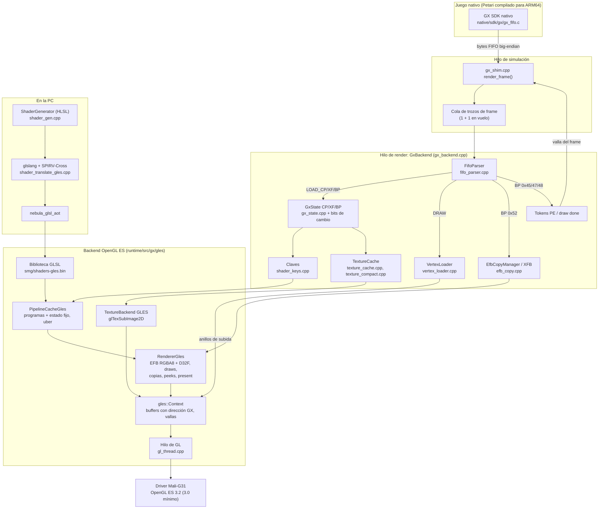

# GX-ES: auditoría técnica del backend GX de Nebula

Paso 1 de GX-ES (backend GX sobre OpenGL ES 3.0 para la Anbernic RG35XX H con muOS y PortMaster). Es solo una
auditoría: no cambia código.

- **Commit auditado:** `b73a2d866cbb3e68bd93b1e148171aa6c1d7647c`, rama `rg35xxh-arm64`.
- **Documentos leídos:** GRAPHICS_ARCHITECTURE.md, ARCHITECTURE.md, BUILDING.md, PROVENANCE.md, NATIVE_PORT.md,
  RG35XXH.md y GX-ES.md.
- **Datos del aparato:** Nebula Probe 0.3 en la RG35XX H con KNULLI 42, la base de ULTRA-GLES del 23-oct-2026 y los logs
  de la consola.
- **Claves:** las 977 de una vuelta entera al juego (`platform/android/vk_seed_keys.bin`), contadas para esta auditoría.

Documentos de esta auditoría:

| Documento | Contenido |
|---|---|
| GX_ES_AUDIT.md (este) | Qué hace el backend, TEV, framebuffer, diagrama, informe final |
| [GX_ES_COMPONENT_MAP.md](GX_ES_COMPONENT_MAP.md) | Tabla componente → archivo → función → dependencias → acción |
| [GX_ES_COMPATIBILITY.md](GX_ES_COMPATIBILITY.md) | Puntos A-H: escritorio, ARM64, GLES 3.0, Mali-G31, precisión, RAM, sincronización, llamadas |
| [GX_ES_RISK_REGISTER.md](GX_ES_RISK_REGISTER.md) | Riesgos CRÍTICO/ALTO/MEDIO/BAJO con causa, impacto, solución y prueba |
| [GX_ES_MIGRATION_PLAN.md](GX_ES_MIGRATION_PLAN.md) | Los 10 pasos pedidos, lo que ya está y las dependencias |
| [GX_ES_TEST_PLAN.md](GX_ES_TEST_PLAN.md) | Pruebas por módulo, comparación de imágenes y tolerancias |

## Antes que nada: lo que el pedido supone y lo que hay

El pedido parte de que GX-ES está por hacer y pide no tocar todavía el backend. En el repositorio:

1. **Ya existe un backend OpenGL ES** (`runtime/src/gx/gles/`: `RendererGles`, `PipelineCacheGles`, `gles::Context`,
   `TextureBackend` de GLES, hilo de GL, ULTRA-GLES). Corre Super Mario Galaxy en la RG35XX H con KNULLI. La medición
   del 23-oct (ULTRA): 21.0 FPS mostrados, 8.2 dibujados, 0 errores de GL, 180 draws por frame, 0.0 % de draws con el
   uber.
2. **La base OpenGL ES 3.0 ya se hizo**, en el commit auditado (`b73a2d86`, pedido anterior), y se probó en la PC con
   Mesa en 3.0 real. En la consola el driver da 3.2 y ese camino no se usa.
3. **muOS no está medido.** El lanzador y el instalador conocen sus rutas, pero todas las mediciones son de KNULLI.

Así que este documento audita ese backend y dice qué falta para el objetivo de GX-ES: Galaxy correcto y a 30, 45 y
60 FPS en la Mali-G31. "Reescribir" no aplica a nada; lo que hay es completar y corregir.

## 1. Qué hace realmente el backend GX

Un frame (cabecera de `gx_backend.h`):

1. El hilo de simulación pasa los bytes del FIFO a una cola acotada y vuelve.
2. El hilo de render los analiza en orden: las cargas de registros cambian `GxState`. Cada draw aplica el estado sucio
   a claves y constantes, pide el programa, las texturas y los vértices, y llama a `RendererGles::draw`. BP 0x52 hace
   la copia EFB (a pantalla, a textura o limpieza).
3. Al final `present` muestra el XFB que eligió la interfaz de video. Los tokens PE se ligan a la valla de ese frame.
4. Un comando, registro o puntero desconocido lanza `GxFatalError` y escribe un `.gxdump`: nunca se ignora en silencio
   (GRAPHICS_ARCHITECTURE.md, "Design decisions").

## 2. Auditoría del TEV

**Dónde está:**

- **Generador:** `ShaderGenerator::generate_ps` en `runtime/src/gx/shader_gen.cpp`. Su cabecera nombra Dolphin
  PixelShaderGen como referencia para la comparación, los swaps y la niebla; PROVENANCE.md dice que no se copió código.
- **Clave:** `PixelShaderKey` en `shader_keys.h`.
- **Constantes:** `GxPsConstants`, 768 bytes, en `uber_constants.h`.
- **Uber:** `uber_ps.hlsl`, 6 variantes.

| Aspecto | Implementación [código] | Lo que usa Galaxy [claves: 741 pixel shaders distintos] |
|---|---|---|
| Etapas | Hasta 16 (`kMaxTevStages`); cada etapa es su `color_env`, `alpha_env`, orden y ksel tal como el registro (`TevStagePacked`); lo que sobra va a cero | 1 etapa: 364 pipelines; 2: 378; 3: 201; 4: 28; 5, 6 y 8: 2 cada uno. Máximo 8 |
| Operaciones de color y alfa | `a*(1-c) + b*c + d` con bias, escala, resta y clamp; registros como `int4` en la malla de 8 bits (`tev_prev_i`, `tev_c_i`) | 76 de 1441 etapas sin clamp de color |
| Registros | PREV y REG0-2 iniciales en `tev_regs` (constantes, no clave) | — |
| Constantes (konst) | `konst[4]` en constantes; la selección (kcsel/kasel) en la clave | 736 de 1441 etapas leen konst (517 pixel shaders) |
| Swaps | Las tablas de swap ya resueltas en la clave (`ksel` bits 10-25) | — |
| Comparaciones | Modo comparación (bias = 3): R8, GR16, BGR24, RGB8, mayor o igual (`TevCompareKind`, `TevCompareOp`) | 18 etapas en 18 pixel shaders |
| Alpha test | Dos comparaciones y lógica AND/OR/XOR/XNOR en enteros de 8 bits; el caso que nunca pasa da `discard` | Siempre pasa: 739 + 83; rango GEQUAL/LEQUAL: 86; otros 69 |
| Texturas indirectas | Hasta 4 etapas indirectas (`ind_cmd`, `ind_mtx`, escalas); muestreo indirecto adaptado de Aurora (`texture_sampling.h`) | 1 etapa indirecta: 227 pipelines; ninguno con más |
| Iluminación | Por vértice en el VS: 2 canales de color y 2 de alfa, 8 luces, difusa y atenuación (`generate_vs`, `channel[4]` de la clave); por píxel solo con `RenderConfig::per_pixel_lighting` (D3D12) | 450 pipelines iluminados; 910 con un canal |
| Texgen | Hasta 8, regular, post-matriz (dual-tex), índices de matriz por vértice | 0: 73; 1: 452; 2: 302; 3: 135; hasta 8 |
| Niebla | Tipo en la clave, parámetros en constantes | Lineal: 35; sin niebla: 942 |
| Z-textura | Profundidad desde la última textura del TEV (reemplazo o suma) | 8 pipelines (la limpieza de Z de Galaxy) |
| Formato del EFB | RGBA6 (alfa de 6 bits, color de 6 u 8, dither) o RGB8 cuantizados en el shader | RGBA6_Z24: 973; RGB8_Z24: 4 |
| Alfa de destino | `GXSetDstAlpha`: la salida lleva la alfa constante | 475 pipelines; 241 además mezclan con la alfa del TEV (doble fuente) |
| Precisión | float32 con redondeo a 8 bits antes de comparaciones y alpha test | Mali: highp de 23 bits en el fragment [sonda] |

**Caché de shaders:**

- **En la PC:** `nebula_glsl_aot` traduce lo que piden las claves a `smg/shaders-gles.bin`, en 5 formas (3.20 y 3.10, cada
  una con la paleta en texture buffer o storage; y 3.00), 4894 shaders.
- **En la consola:**
  - La clave HLSL busca el GLSL en esa biblioteca.
  - El programa se enlaza en un hilo con contexto propio y se guarda como binario del driver (`gles-<driver>/`); cargar
    uno cuesta 0.3 ms frente a 27 ms de compilarlo [sonda].
  - Lo que no está en la biblioteca se dibuja con el uber y su clave se anota en `gles_keys.bin`, para que
    `nopal nebula shaders` la agregue después.

**¿Reutilizar el traductor o escribir uno nuevo?** Reutilizarlo:

- **Por qué:** el GLSL ES 3.00/3.10/3.20 que sale del HLSL del generador enlaza con el driver de Mali (los 892
  programas, en la consola) y con Mesa en 3.0 (989 programas, en la PC). Los 1978 shaders de 3.00 pasan el validador de
  referencia de Khronos. El generador es el mismo para D3D12, Vulkan y GLES, así que un arreglo del TEV llega a los tres.
- **Qué costaría uno nuevo:** un generador GLSL directo quitaría glslang y SPIRV-Cross de la PC. A cambio duplicaría
  `shader_gen.cpp` (2683 líneas) y sus correcciones, y la consola no lo nota: ya no traduce nada.
- **Lo que falta cambiar:** la doble fuente (ver 3 y GX_ES_COMPATIBILITY.md D), que se resuelve dentro del generador
  más una forma de shader nueva, no con otro traductor.

## 3. Auditoría del framebuffer

| Función GX | Cómo lo hace Nebula en GLES [código] | Correspondencia con OpenGL ES 3.0 | ¿Equivalencia directa? |
|---|---|---|---|
| EFB color | Textura `GL_RGBA8` de 640x528 por la escala (o 50-100 % con `GALAXY_GLES_RESOLUTION`) en un framebuffer propio (`RendererGles::create_efb`) | `glTexStorage2D` RGBA8 + `glFramebufferTexture2D` (ES 3.0) | No: GX tiene RGB8, RGBA6 y RGB565. Se dibuja en RGBA8 y el shader cuantiza a 6 bits con dither (RGBA6, 973 de 977 pipelines) |
| EFB profundidad | `GL_DEPTH_COMPONENT32F`, Z invertida (lejos ≈ 0); `clear_z24` → `reversed_depth` | Formato de ES 3.0; `glClearDepthf` | No hay Z24 de GX: 32F contiene el z24 exacto (los peeks devuelven el valor escrito, `nebula_gles_renderer_tests`) |
| Formatos Z16 y RGB565 de GX | Mismo EFB, el formato se aplica al leer o copiar | — | No usados por Galaxy en la vuelta (pixfmt 0 y 1 solamente) [claves] |
| XFB | `XfbTexture` por dirección guest (`EfbCopyManager`); nada se escribe en la memoria del juego | Textura RGBA8 | Sí (no hay YUV en memoria: la presentación lee la textura) |
| GXCopyDisp | `copy_efb_to_xfb`: el shader de conversión con escala vertical, filtro de 3 tomas, gamma, YUV si el juego lo pide, y los filtros opcionales (nitidez, FXAA) en la misma pasada | Dibujo de pantalla completa en el framebuffer del XFB | Sí, con shader |
| GXCopyTex | `copy_efb_to_texture` + `record_conversion_blit`: textura RGBA8 por (dirección, formato, color/Z, nativa), registrada en `TextureCache::register_efb_copy`; presupuesto de 64 MiB con expulsión LRU | Dibujo a una textura RGBA8; el formato de destino se aplica en el shader | No para formatos de 4 o 16 bits: se guardan en RGBA8 con el valor ya convertido. Si no hay memoria para el destino, la copia se omite con un aviso en el log (`[efb-copy] ... copy skipped`) |
| Copy-clear | Tras la copia, `clear_efb` con el rectángulo de origen, las máscaras de color, alfa y Z vigentes y el color/Z de BP 0x4F-0x51; si cubre todo el EFB, sin scissor | `glClear` con `glColorMask`/`glDepthMask` y scissor | Sí. En GLES, una copia a pantalla que limpia toda la Z marca la profundidad para descartarla (`discard_efb_depth_at_next_copy`, `glInvalidateFramebuffer`): ahorra cargar tiles en la Mali |
| Texturas desde el EFB | El draw que lee la dirección de la copia ata la textura de la copia; las unidades se desatan tras cada copia para que un draw nunca lea el EFB mientras dibuja en él | `glBindTexture` | Sí |
| Peeks (`GXPeekARGB`/`GXPeekZ`) | Síncrono (dibuja el texel en un objetivo de 1x1 y lo lee) o asíncrono (campos de 640x528 o reducidos, leídos por PBO cuando pasa su valla) | `glReadPixels` a un pixel-pack buffer + `glFenceSync` | Sí |
| Sincronización | GL ejecuta en orden: una copia o un peek ve los draws anteriores; vallas por frame con 4 frames en vuelo | `glFenceSync`/`glClientWaitSync` (ES 3.0) | Sí |
| Presentación | `present`: el XFB elegido (o el anterior si la selección está entre estados), `glBlitFramebuffer` invertido (el EFB se dibuja con la fila de arriba primero, como D3D) | `glBlitFramebuffer` (ES 3.0) | Sí |

## 4. Informe final

### 4.1 Qué hace realmente el backend GX actual

Analiza el flujo GX que escribe el SDK del juego nativo. Mantiene el estado CP/XF/BP con bits de cambio y convierte
cada draw en vértices canónicos, una clave de pipeline y constantes. Dibuja en un EFB fuera de pantalla, hace las copias
EFB → textura y EFB → XFB en la GPU y presenta el XFB que el juego eligió. Todo eso con tres backends: D3D12 (Windows),
Vulkan (Android) y OpenGL ES (la RG35XX H). Los shaders son HLSL generados por clave; en la consola llegan ya en GLSL
desde la PC. Lo desconocido falla con un `.gxdump`, no se salta.

### 4.2 Qué podemos reutilizar

Todo el núcleo GX: `fifo_parser.cpp`, `gx_state.cpp`, `vertex_loader.cpp`, `shader_keys.cpp`, `shader_gen.cpp`,
`texture_cache.cpp`, `texture_compact.cpp`, `efb_copy.cpp`, `renderer_common.cpp`, `upload_ring.cpp` y
`gx_backend.cpp`. También el backend GLES existente y sus herramientas (biblioteca GLSL, ULTRA-GLES, hilo de GL).

### 4.3 Qué debemos adaptar

- La doble fuente: 241 de 977 pipelines mezclan con la alfa equivocada en GLES (deducido del código).
- El LOD bias de los samplers, que hoy se ignora.
- Las líneas anchas: 3 pipelines; la Mali tiene geometry shaders.
- El tamaño de los anillos de subida: 160 MiB reservados frente a unos 4 MiB por frame usados en un menú.
- El costo de CPU del hilo de render: 35.5 ms por frame, la causa de que no lleguemos a 30 FPS.
- El arreglo opcional de Z temprana en 3.0.

### 4.4 Qué debemos reescribir

Nada. El backend D3D12 y el Vulkan no se usan en la RG35XX H y se dejan como están.

### 4.5 Los cinco riesgos técnicos más importantes

Detalle en GX_ES_RISK_REGISTER.md.

1. **(ALTO) Blending de doble fuente.** Sin `GL_EXT_blend_func_extended` en la Mali, el 24.7 % de los pipelines mezcla
   con la alfa constante en vez de la del TEV.
2. **(ALTO, rendimiento) CPU del hilo de render.** 35.5 ms por frame (8.2 frames dibujados por segundo, 21 mostrados):
   lo que separa de 30 FPS.
3. **(MEDIO) Memoria.** El juego deja 177 MiB libres como mínimo, de 973, y los anillos reservan 160 MiB.
4. **(MEDIO) Lecturas del EFB.** En modo sync causaban 1506 de 4842 tirones; el modo async (por defecto) los evita, a
   cambio de contestar con un frame de retraso.
5. **(MEDIO) Firmwares sin medir.** muOS y el driver 3.0 nunca se probaron en el aparato.

### 4.6 Dependencias

| | |
|---|---|
| En la consola | SDL2 del firmware (driver `mali`), EGL y GLES 3 de Mali (OpenGL ES 3.0 como mínimo), glibc ≥ 2.27, libstdc++ estática. Nada más (`nebula` de 3.4 MB sin traductor) |
| En la PC | clang/lld y la toolchain aarch64 (crosstool-NG, glibc 2.27); glslang, SPIRV-Tools, SPIRV-Headers y SPIRV-Cross (versiones fijas en `armar.sh`) para la biblioteca GLSL; SDL2 para enlazar |
| Dentro del repositorio | zlib (`third_party/archive/zlib`), bcdec, stb, cabeceras Khronos; Petari en `native/petari` |
| No | Vulkan (no existe en la consola), Direct3D, FXC/DXC |

### 4.7 Archivos que se modificarían en el siguiente paso

Si se aprueba empezar por el riesgo 1 (doble fuente):

| Archivo | Cambio |
|---|---|
| `runtime/src/gx/shader_gen.cpp` | Opción `ShaderGenOptions` para mezclar en el shader con el color del framebuffer |
| `runtime/include/galaxy/gx/shader_gen.h` | Esa opción |
| `runtime/src/gx/gles/shader_translate_gles.cpp` | La lectura del framebuffer (`gl_LastFragColorARM`, `#extension GL_ARM_shader_framebuffer_fetch`) |
| `runtime/src/gx/gles/pipeline_cache_gles.cpp` | Blending fijo apagado para esos pipelines |
| `runtime/src/gx/gles/shader_sources_gles.cpp`, `platform/knulli/game/glsl_aot.cpp` | La forma de la biblioteca que lleva la opción |
| `platform/knulli/game/gles_renderer_tests.cpp` | La prueba del caso |

Para el riesgo 2 (rendimiento), los archivos salen de un perfil en la consola, no de esta auditoría:
`gx_backend.cpp` (`flush_draw_state`), `vertex_loader.cpp` y `renderer_gles.cpp` son los candidatos por lo medido.

### 4.8 Qué pruebas faltan

Detalle en GX_ES_TEST_PLAN.md.

- `vertex_loader_tests` y `shader_gen_tests` no compilan fuera de Windows: dependen de D3D12 y FXC.
- No hay comparación de imágenes entre backends ni contra una referencia.
- No hay prueba del blending de doble fuente ni del LOD bias.
- Nada se probó en un driver 3.0 real ni en muOS.
- Falta medir en la consola el camino de 3.0 (`GALAXY_GLES_FORCE_ES30=1`).

### 4.9 Dificultad y esfuerzo por módulo

Es una estimación, no una medición. "Días" son días de trabajo de una persona con el repositorio y la consola a mano.

| Módulo | Estado | Dificultad | Esfuerzo que falta |
|---|---|---|---|
| FIFO, CP/XF/BP | Hecho y compartido | — | 0 (pruebas en Linux: 0.5 días) |
| Vertex Loader | Hecho | Baja | 1-2 días para sus pruebas en Linux; reducir el vértice de 144 bytes sería un cambio mayor (5+ días) |
| TEV / generador | Hecho; falta la doble fuente | Media | 2-4 días (doble fuente con framebuffer fetch y su prueba) |
| Texturas | Hecho | Baja | LOD bias: 1-2 días |
| EFB/XFB | Hecho | Baja | 0-1 días (líneas anchas: 2-3 días si hacen falta) |
| Pipeline / caché | Hecho | Baja | 0 |
| Sincronización | Hecha | Media | 0 en código; la memoria de los anillos: 1 día |
| Rendimiento a 30 FPS | Lejos (8.2 dibujados) | Alta | Depende del perfil en la consola; varias semanas, sin garantía de llegar con el ARM A53 |
| Conformidad visual | Sin herramienta | Media | 3-5 días (captura de referencia y comparación) |
| muOS | Sin medir | Baja | 1 día con la consola |
