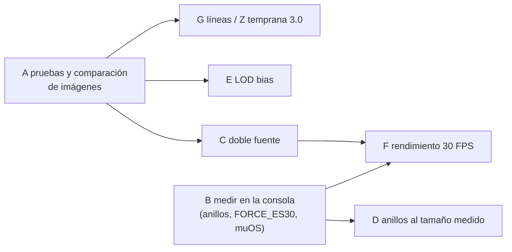

# GX-ES: plan de migración

Commit `b73a2d86`. Los diez pasos del pedido, en el orden que minimiza cambios al código original, con lo que ya está
hecho. Como el backend GLES existe (GX_ES_AUDIT.md), la mayoría de los pasos están cumplidos. Lo que queda son
correcciones dentro del backend y del generador, más la medición.

## Estado de los diez pasos

| # | Paso | Estado en `b73a2d86` | Dónde | Lo que falta |
|---|---|---|---|---|
| 1 | Identificar interfaces del backend | Hecho | `FifoSink` (`fifo_parser.h`); la interfaz que `GxBackend` usa de su renderer (la misma en `RendererD3D12`, `RendererVk` y `RendererGles`); `gpu_types.h`; `TextureBackend` | — |
| 2 | Separar lógica GX de implementación gráfica | Hecho | El núcleo GX (`fifo_parser`, `gx_state`, `vertex_loader`, `shader_keys`, `shader_gen`, `texture_cache`, `efb_copy`) no incluye cabeceras de un API; `gx_backend.h` elige el backend con `NEBULA_GPU_*` | 10 bloques `#if NEBULA_GPU_GLES` en `gx_backend.cpp` (diagnóstico, peeks, decodificación en hilos): se pueden dejar |
| 3 | Definir interfaz de dispositivo gráfico | Hecho | `gles::Context` (`gles_context.h`): capacidades, buffers con dirección GX, texturas, vallas, borrado diferido | — |
| 4 | Preparar backend GLES | Hecho; base 3.0 hecha en la PC | `runtime/src/gx/gles/`, `host_window_knulli.cpp` | La vuelta en la consola con `GALAXY_GLES_FORCE_ES30=1` |
| 5 | Adaptar shaders | Hecho, con un caso pendiente | HLSL → GLSL ES en la PC (`nebula_glsl_aot`, `smg/shaders-gles.bin`) | **Doble fuente** (R-01) |
| 6 | Adaptar texturas | Hecho, con un caso pendiente | `texture_backend_gles.cpp`, texturas compactas, packs | **LOD bias** (R-05) |
| 7 | Implementar EFB/XFB | Hecho | `renderer_gles.cpp`: EFB RGBA8 + D32F, copias, peeks, presentación | Líneas anchas (R-11), si hacen falta |
| 8 | Integrar sincronización | Hecho | Vallas por frame, 4 frames en vuelo, peeks async, hilo de GL | Tamaño de los anillos (R-03) |
| 9 | Pruebas de conformidad | Parcial | Pruebas del renderer y de shaders en Linux; ULTRA en la consola | Comparación de imágenes (GX_ES_TEST_PLAN.md); pruebas del cargador y del generador en Linux (R-12) |
| 10 | Integrar con Mario Galaxy | Hecho en KNULLI | El port (`armar.sh`, `smg.zip`) | muOS (R-09); 30 FPS (R-02) |

## Orden propuesto para lo que falta

Cada paso es un commit que compila para x86-64 y aarch64 y pasa las pruebas existentes. No se elimina código y no cambia
la semántica de GX: cada corrección acerca el resultado al del hardware.

| Orden | Trabajo | Archivos | Depende de | En paralelo con |
|---|---|---|---|---|
| A | Pruebas de conformidad mínimas: la herramienta de comparación de imágenes y las pruebas del cargador y del generador compilables en Linux (sin D3D12) | `platform/knulli/game/` (pruebas nuevas), `runtime/src/gx/vertex_loader_tests.cpp`, `shader_gen_tests.cpp` (separar la parte de D3D12) | — | B, C |
| B | Medir en la consola lo que dicen los datos: pico de los anillos en una vuelta, `FORCE_ES30`, muOS | Solo ajustes (`smg/ajustes.cfg`) | — (la consola) | A |
| C | Doble fuente con `GL_ARM_shader_framebuffer_fetch` (R-01) | `shader_gen.cpp`/`.h`, `shader_translate_gles.cpp`, `pipeline_cache_gles.cpp`, `shader_sources_gles.cpp`, `glsl_aot.cpp`, prueba del renderer | A (prueba) | A, B |
| D | Anillos al tamaño medido (R-03) | `Super Mario Galaxy.sh` (valores por defecto) | B | C |
| E | LOD bias en el shader (R-05) | `shader_gen.cpp` (opción), `renderer_gles.cpp` (el sesgo como constante) | A | C, D |
| F | Rendimiento hacia 30 FPS (R-02), con el perfil en la consola primero | Según el perfil: `gx_backend.cpp`, `vertex_loader.cpp`, `renderer_gles.cpp` | B | — (cada cambio se mide solo) |
| G | Líneas anchas (R-11) y Z temprana en 3.0 (R-10), si las capturas lo piden | `shader_gen.cpp`, `pipeline_cache_gles.cpp` | A | F |

F va al final porque cambia tiempos y no imagen, y conviene medirlo con las correcciones de imagen ya puestas: así no se
mezclan los efectos en las series de ULTRA.

## Qué no se hace

- No se reescribe el backend D3D12 ni el Vulkan. Siguen compilando en sus plataformas; GX-ES no los incluye.
- No se cambia la lógica de recompilación (`crates/`, `native/`).
- No se quitan las comprobaciones de `GxFatalError`.
- No se agregan dependencias en la consola. Framebuffer fetch y geometry shaders son extensiones del driver que ya tiene.
